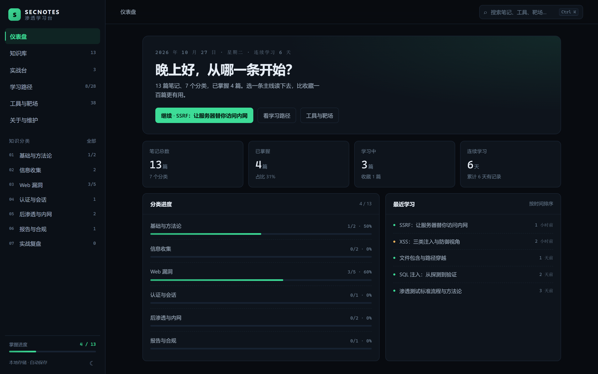
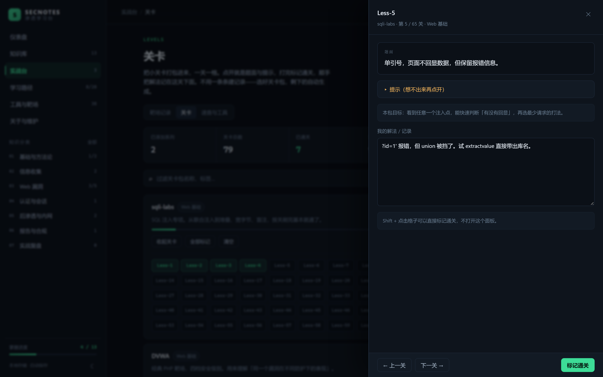

# SECNOTES · 个人网络渗透学习台

一个零依赖的静态学习网站：知识分类导航、笔记与进度记录、工具/靶场索引、全局检索。
没有后端、没有账号、没有 npm 依赖，整个目录拷走就能用。

<p align="center">
  
  
</p>

## 快速开始

```bash
# Windows：双击 start.bat
# macOS / Linux / WSL：
./start.sh          # 默认 http://127.0.0.1:8787

# 或者任意静态服务器
python -m http.server 8787 --bind 127.0.0.1
```

浏览器打开 `http://127.0.0.1:8787`。

> 直接双击 `index.html` 也能打开：正文会使用内置全文包（`content/notes-bundle.js`），
> 但新增笔记后必须重新生成索引才会出现。日常建议用脚本起服务，改 `.md` 刷新即生效。

## 功能

| 模块 | 说明 |
|------|------|
| 仪表盘 | 掌握度、分类进度、连续学习天数、继续上次阅读 |
| 知识库 | 七个分类 → 笔记列表 → 阅读页（正文 + 页内目录 + 状态/收藏） |
| **实战台** | 靶场记录（增删改查、状态、统计、导出 Markdown）+ 关卡包 + 速查工具箱 |
| 学习路径 | 四阶段 28 个任务，勾选即记录进度，任务可跳转笔记 |
| 工具与靶场 | 24 个工具（含安装命令一键复制）+ 14 个靶场，分类筛选 |
| 全局检索 | `Ctrl/⌘ + K`，标题/标签/正文全文，结果分组并高亮关键词 |

### 实战台

**靶场记录**：每打一台机器记四件事——从哪进的、用了什么凭据、怎么提权、卡在哪。
记录支持平台/难度/状态/日期/标签，卡片点开即编辑。

「导出 Markdown」会生成带 front-matter 的复盘笔记，放进 `content/notes/labs/`
再跑一次索引脚本，这条记录就并入知识库，成为可检索、可双链的一篇。

**关卡**：把系列关卡打包进来，一关一格。**点格子打开题面**，打完标记通关。
每题带一句「这关考什么」+ 一条折叠提示，下面可以记自己的 payload 与卡点（自动保存）。

- 内置：sqli-labs（65，逐关标注注入类型）、upload-labs（21，逐关标注校验层级）、
  XSS-labs（20）、DVWA（14 个模块）、红日 VulnStack（5 套）
- 「一键添加 65 关」= 自动生成整套条目，不用一条条建
- **Shift + 点击** = 不打开题面直接标记通关（批量打卡）
- 「自定义关卡包」按数量生成，题面留空，可自己写
- 命名型关卡（DVWA 那种按模块名的）在 `content/levels.js` 里加 `kind: 'named'` 和 `items`
- 题面按常见版本整理，不同版本/魔改版可能略有差异，以靶场页面为准

**速查与工具**（全部本地计算，不联网）：

| 工具 | 用途 |
|------|------|
| 编解码 | URL / Base64 / Hex / HTML 实体 / Unicode，双向 + 互换 |
| 哈希 | SHA-1 / 256 / 384 / 512（Web Crypto；MD5 需命令行） |
| JWT 解析 | 解出 header/payload，提示 exp、alg=none、弱密钥、kid/jku 风险 |
| 网段计算 | 网络地址、广播、可用范围、主机数、是否内网/元数据段 |
| 速查片段 | 31 条检测片段，按分类过滤，一键复制 |

进度（状态、收藏、阅读位置、清单勾选、路径任务、靶场记录、关卡通关与解法）存在浏览器 `localStorage`，
键名 `secnotes.v1`，可在「关于与维护」页导出 / 导入 JSON。

## 目录结构

```
ctf/
├── index.html              单页入口
├── start.bat / start.sh    本地服务
├── assets/
│   ├── style.css           全部样式（明暗两套主题）
│   ├── app.js              路由、渲染、状态存储、检索面板
│   ├── markdown.js         极简 Markdown 渲染器（零依赖）
│   ├── search.js           内存检索索引
│   ├── lab.js              实战台：靶场记录与抽屉表单
│   └── toolbox.js          编解码 / 哈希 / JWT / CIDR / 速查
├── content/
│   ├── categories.js       分类（手工维护）
│   ├── library.js          笔记索引（自动生成，勿手改）
│   ├── notes-bundle.js     全文兜底包（自动生成，勿手改）
│   ├── tools.js            工具与靶场（手工维护）
│   ├── roadmap.js          学习路径（手工维护）
│   ├── cheats.js           实战速查片段（手工维护）
│   ├── levels.js           关卡包定义（手工维护）
│   └── notes/              正文
│       ├── basics/   recon/   web/
│       ├── auth/     post/    report/
│       └── labs/     ← 从实战台导出的复盘放这里
├── tools/build-index.js    扫描 notes 生成索引
└── README.md
```

## 加一篇笔记

1. 在 `content/notes/<分类>/` 下新建 `.md`，开头写 front-matter：

```markdown
---
title: 标题
category: web
tags: [SSRF, 内网]
summary: 一句话摘要，会显示在卡片上
level: 2        # 1 基础 / 2 进阶 / 3 高阶
minutes: 12
order: 6        # 同分类内排序
updated: 2026-10-27
---
```

2. 重新生成索引：

```bash
node tools/build-index.js
```

3. 刷新页面。正文里可以用 `[[另一篇的 id]]` 做双链跳转（id 就是文件名去掉 `.md`）。

判断规则：**只改已有笔记的正文**不用重建索引（服务模式下直接读 `.md`）；
**新增/删除/改名**才需要跑一次脚本。

## 部署

- 本地：上面的启动脚本即可
- 长期使用：整个目录 `git init` 做版本管理，正文改动有历史可查
- 托管：任意静态站点都能放，但这是个人笔记，**不要公开部署**

## 设计取舍

- **不用框架**：无构建产物、无依赖升级，几年后打开仍能跑
- **不用数据库**：个人数据量小，localStorage + 导出备份足够
- **内容与界面解耦**：正文是纯 Markdown，随时能搬到别的工具
- **索引可重建**：`library.js` 是生成物，删掉重跑即可，不会丢内容

## 免责声明

本项目仅用于个人学习与授权范围内的安全测试。站内技术内容不构成对任何具体系统的攻击指导；
对未授权目标进行探测或入侵可能触犯法律。练习请使用公开靶场或自建环境。
